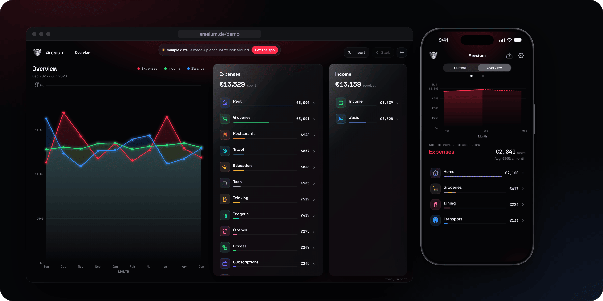
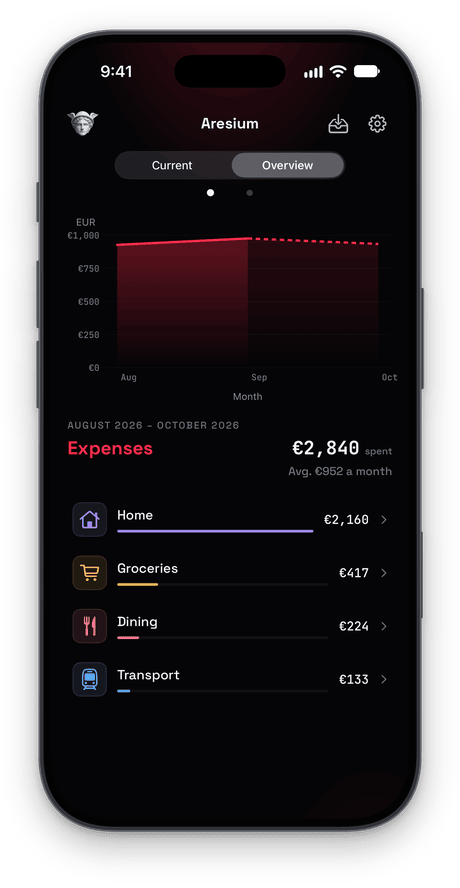
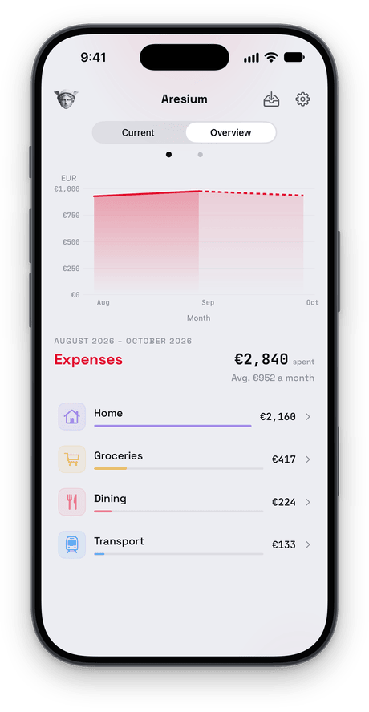
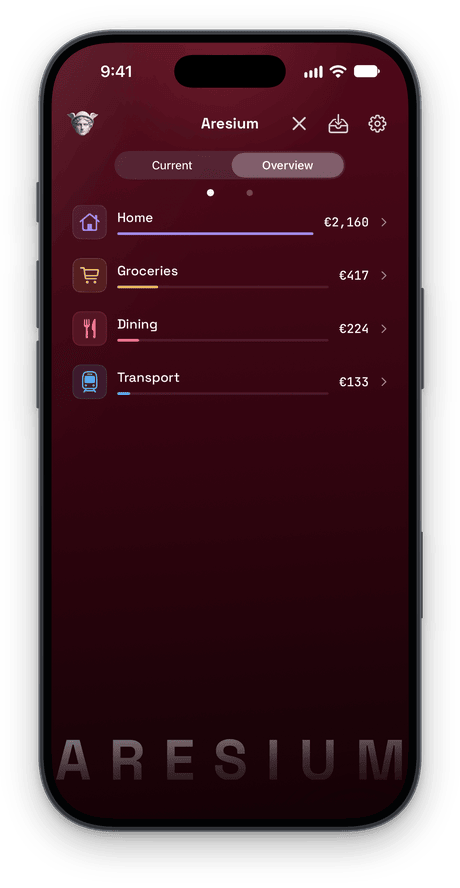
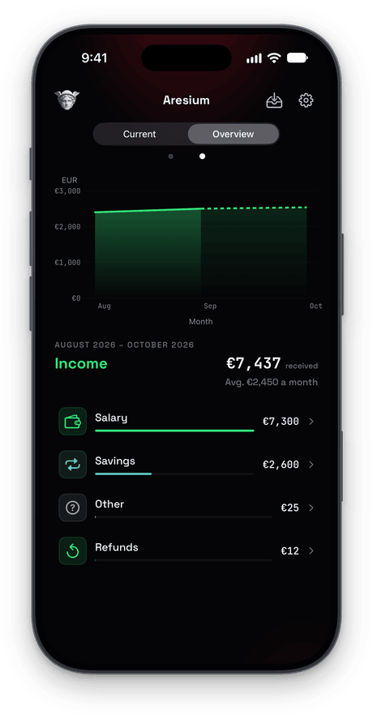
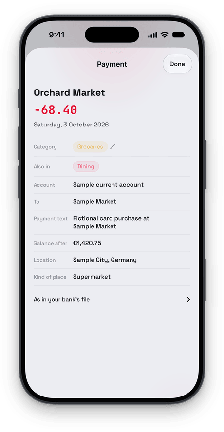
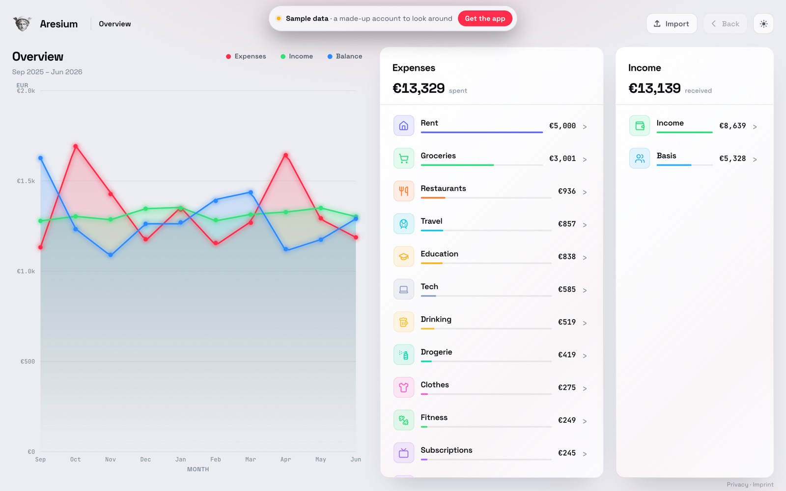

<p align="center">
  
</p>

# Aresium

Personal finance from your bank's own exports: import, sort and understand where the money goes. A web dashboard and a
native iPhone app that keeps your data on the iPhone.

**[Try the demo](https://aresium.de/demo)** · [The iPhone app](https://patrikbreeck.com/en/apps/#aresium) ·
[Its code](https://github.com/Ares-Empire/empire-ios)

## What it does

- **Reads bank exports.** CSV, CAMT and MT940 files from 25 German banks and PayPal. A layout it hasn't seen is read
  once you confirm its columns. No bank login and no aggregator in between.
- **Sorts by itself.** A rule engine with 2,815 known shops and local businesses from OpenStreetMap puts each payment
  into a category, and learns from every correction.
- **Shows where the money goes.** Spending and income by month and category, each day's payments, the monthly average
  and the fixed costs (rent, subscriptions, insurance), found on their own.
- **Makes fixing quick.** A quick sort for what's left, several payments selected at once as in Mail, a shop renamed
  once for all its payments, and money paid back linked to its expense so only your share counts.
- **Keeps it private.** On the iPhone everything stays on the device: no account, no server, an optional Face ID lock,
  and export and restore as one file.
- **Details.** Receipts from a photo, widgets, light, dark and a red mode, English and German.

## Screenshots

<table>
  <tr>
    <td></td>
    <td></td>
    <td></td>
    <td></td>
    <td></td>
  </tr>
</table>



## How it's built

- **One engine.** Reading the files, sorting and counting live in TypeScript (`src/engine`). The server runs it, and
  the iPhone app runs the same code bundled in JavaScriptCore, so both count alike.
- **The server.** Node serves the dashboard and the JSON API (`src/web`), PostgreSQL with Prisma stores the data, and
  the importers and helpers are npm scripts.
- **The website.** Plain HTML, CSS and JavaScript in `web/public`, with no build step.
- **The iPhone app.** SwiftUI, in the [empire-ios](https://github.com/Ares-Empire/empire-ios) repository.

## Run it locally

```sh
npm ci
cp .env.example .env                   # DATABASE_URL for the local Docker database
npm run db:up && npm run db:push && npm run seed
npm run import                         # the bank files in imports/ (docs/SETUP-IMPORT.md)
npm run web                            # http://127.0.0.1:5173
npm test && npm run typecheck
```

`npm run web` needs a small owner file for the contact page (`$ARES_OWNER_FILE`, else
`~/.config/ares-empire/owner.json`). More in [docs/DEVELOPMENT.md](docs/DEVELOPMENT.md), the data API in
[docs/API-DATA.md](docs/API-DATA.md) and the design in [docs/ARCHITECTURE.md](docs/ARCHITECTURE.md).
