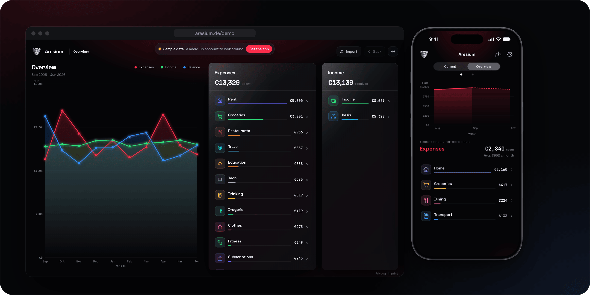
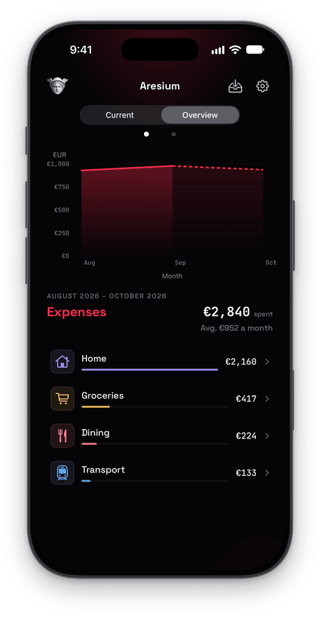
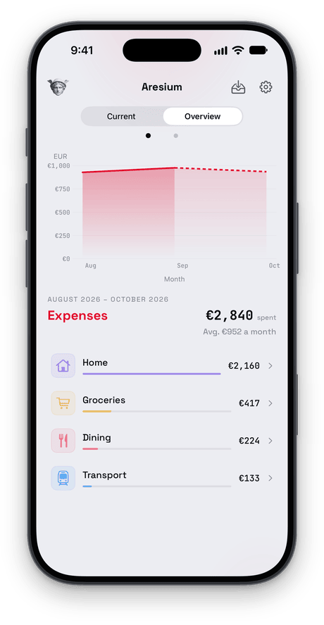
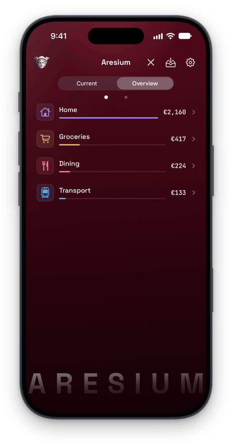
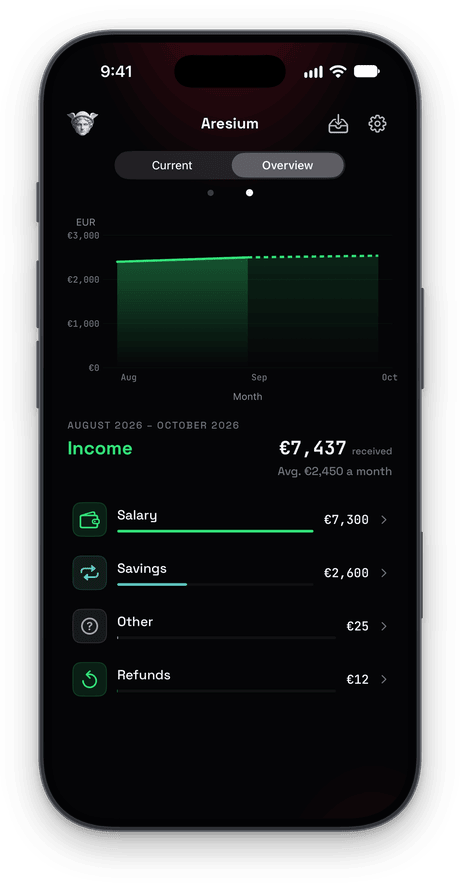
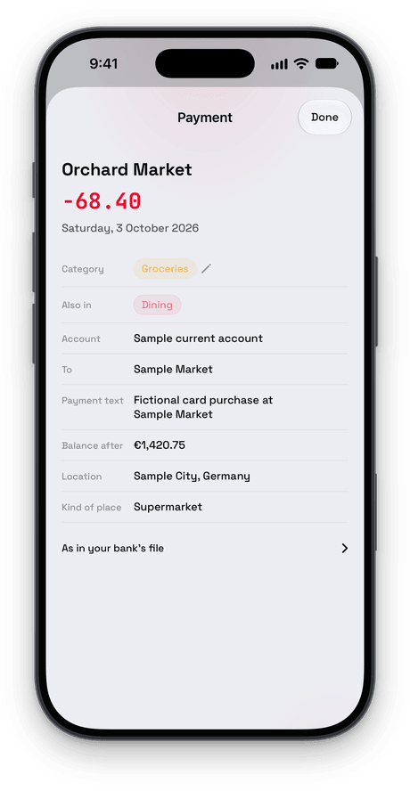
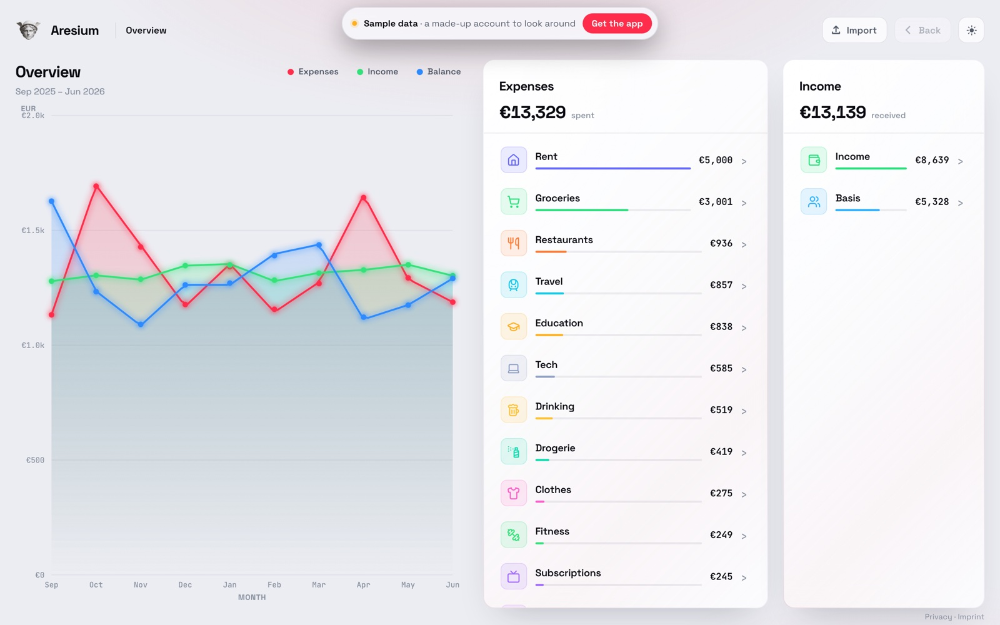

<p align="center">
  
</p>

# Aresium

Personal finance from your bank's own exports: import, sort and understand where the money goes. A web dashboard and a
native iPhone app that keeps your data on the iPhone.

**[Try the demo](https://aresium.de/demo)** · [Get the iPhone app](https://aresium.de/contact?topic=access) ·
[Its code](https://github.com/Ares-Empire/empire-ios)

## What it does

- **Reads bank exports.** CSV files from PayPal and 17 banks (Sparkasse, the Volksbanks and Sparda-Banks, ING, DKB,
  comdirect, N26 and others), CAMT and MT940 files from any bank, Excel sheets (.xlsx) and ZIP files of statements. A
  layout it hasn't seen is read once you confirm its columns. No bank login and no aggregator in between. The
  website's own import reads fewer so far: VR Bank and PayPal CSV files and CAMT files.
- **Sorts by itself.** A rule engine with 3,150 known shop names and words puts each payment into a category, and
  learns from every correction. On the iPhone it also knows about 265,000 local shops, restaurants, practices and
  other places from OpenStreetMap.
- **Shows where the money goes.** Spending and income by month and category, each day's payments, a search by name,
  the monthly average and the fixed costs (rent, subscriptions, insurance), found on their own.
- **Makes fixing quick.** A quick sort for what's left, several payments selected at once as in Mail, a shop renamed
  once for all its payments, and money paid back linked to its expense so only your share counts.
- **Keeps it private.** On the iPhone everything stays on the device: no account, no server, an optional Face ID lock,
  and export and restore as one file.
- **Details.** Receipts from a photo, widgets, light, dark and a red mode, English and German.

## Screenshots

<table>
  <tr>
    <td></td>
    <td></td>
    <td></td>
    <td></td>
    <td></td>
  </tr>
</table>



## How it's built

- **One engine.** Reading the files, sorting and counting live in TypeScript (`src/engine`). The iPhone app runs it
  bundled in JavaScriptCore, and the server runs the same code for the dashboard's numbers, so both count alike. The
  server's own import is older: it reads files with `src/import` and sorts new payments first by rules in the
  database (`src/sync/categorize.ts`).
- **The server.** Node serves the dashboard and the JSON API (`src/web`), PostgreSQL with Prisma stores the data, and
  the importers and helpers are npm scripts.
- **The website.** React and JSX in `web/public`. React and Babel are served from the repository and Babel compiles the
  JSX in the browser, so there is no build step.
- **The iPhone app.** SwiftUI, in the [empire-ios](https://github.com/Ares-Empire/empire-ios) repository.

## Run it locally

```sh
npm ci
cp .env.example .env                   # DATABASE_URL for the local Docker database
npm run db:up && npm run db:push && npm run seed
npm run import                         # the bank files in imports/ (docs/SETUP-IMPORT.md)
npm run web                            # http://127.0.0.1:5173
npm test && npm run typecheck
```

See [docs/DEVELOPMENT.md](docs/DEVELOPMENT.md) for setup, [docs/API-DATA.md](docs/API-DATA.md) for the data API
and [docs/ARCHITECTURE.md](docs/ARCHITECTURE.md) for the design.

## Tests and CI

GitHub Actions runs on every push, pull request and manual start, with public packages and invented data only.
Some tests compare with an older commit, so clone with full history:

```sh
npm ci
npx prisma generate
npm run typecheck
npm test -- --test-concurrency=1
npm run engine
```

Tests run one at a time so the speed tests don't slow each other. No `.env`, database, owner file or personal
configuration is needed. CI uses Node 24, the server's (v24.22.1 on 2026-11-07).

## License

Free to use, change and share for non-commercial purposes, such as study, research, hobby projects, schools and
charities, under the [PolyForm Noncommercial License 1.0.0](LICENSE.md). Commercial use, also inside a company, needs
permission: [ares-empire.de/contact](https://www.ares-empire.de/contact).

The licence covers the code. It does not cover the Ares names, the busts, the app icons or the screenshots. Parts from
others keep their own licences: the local places list and the sorting test set are derived from OpenStreetMap and
stay under the ODbL 1.0 ([data/local-places/LICENCE.md](data/local-places/LICENCE.md),
[eval/sorting/sources/LICENCE.md](eval/sorting/sources/LICENCE.md)); the brand names from the name-suggestion-index
are under BSD-3-Clause (in [src/engine/sorting/shops.de.json](src/engine/sorting/shops.de.json)); React, React DOM
and Babel are under MIT and Lucide under ISC ([web/public/vendor/README.md](web/public/vendor/README.md)); the fonts
Space Grotesk and JetBrains Mono are under the SIL Open Font License 1.1 ([web/public/fonts](web/public/fonts)).
